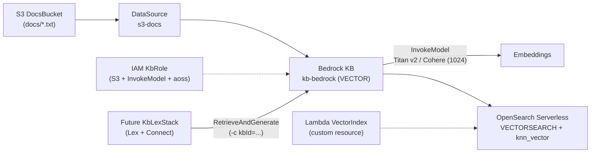

# Demo-KB: Bedrock Knowledge Base + S3 + OpenSearch Serverless (CDK)

IaC companion piece to `demo-cx`: RAG knowledge base
`Docs (S3 docs/) → Bedrock KB → Titan/Cohere embeddings → OpenSearch Serverless (knn_vector 1024)`.

* Single `KbStack`, fixed region `us-east-1`, KB name `kb-bedrock`.
* No VPC by design (like `demo-cx`).
* Everything `DESTROY`: `npm run destroy:kb:dev` releases bucket, collection, role, KB and DS.
* Future `KbLexStack` will consume `KbId` via context `-c kbId=...` (same decoupling as `CxConnectStack -c patientLookupArn`).

## Architecture



Flow: `docs/ (S3)` → ingestion (`300/20 chunking` + embeddings) → vectors in `kb-bedrock-index` → `retrieve` / `retrieve-and-generate` (Nova Micro). The `VectorIndex` Lambda creates the index (CFN has no L1 for indexes) with a stabilization wait for Bedrock validation.

## Structure

```
  _____
./ kb /
├── cdk/bin/kb.ts              # Single app: KbStack (fixed region us-east-1)
├── cdk/lib/kb-stack.ts        # S3 + AOSS + role + KB + DataSource (+ embeddings enum)
├── cdk/lib/vector-index.ts    # knn_vector index construct (custom resource)
├── cdk/test/kb.test.ts        # Synth tests (no VPC, DESTROY resources)
├── cdk/cdk.json               # App + feature flags (CLI runs from here)
├── srv/vector-index/index.ts  # Index PUT/GET/DELETE handler (SigV4 aoss)
├── scripts/seed-docs.mjs      # Uploads sample docs to s3://<bucket>/docs/
├── scripts/ingest.mjs         # StartIngestionJob + waits for COMPLETE
├── scripts/smoke.mjs          # retrieve + retrieve-and-generate (Nova Micro)
└── README.md / HELP.md / DEPLOY.md
```

## Usage

```bash
npm ci
npm run build      # tsc --noEmit
npm test           # jest synth
npm run synth
npm run deploy:kb:dev
npm run seed       # uploads sample docs to s3://<bucket>/docs/
npm run ingest     # StartIngestionJob + waits for COMPLETE
npm run smoke      # retrieve + retrieve-and-generate (Nova Micro)
npm run destroy:kb:dev
```

Switch embeddings (both 1024 dims, same index):

```bash
cd cdk && cdk deploy KbStack -c embeddingModel=cohere-multilingual --require-approval never
```
