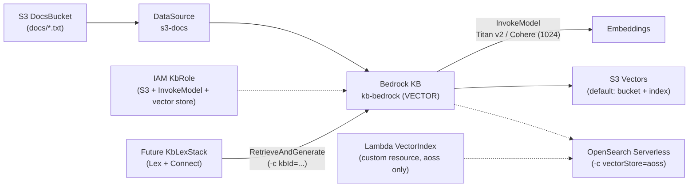

# Bedrock Knowledge Base + S3 + Vector Store

Demo with **CDK** companion piece to [`demo-cx`](https://github.com/kaesar/demo-cx) for **RAG** and knowledge base using:

> `Docs (S3 docs/) –> Bedrock KB –> Titan/Cohere embeddings –> vector store`.

* Single `KbStack`, fixed region `us-east-1`, KB name `kb-bedrock`.
* Vector store enum `KbVectorStore`: `s3-vectors` (**default**, pennies/month, no OCUs, no custom resources) or `aoss` (OpenSearch Serverless VECTORSEARCH + `knn_vector 1024`, ~$175/month minimum). Switch with `-c vectorStore=aoss`.
* No VPC by design (like `demo-cx`).
* Everything `DESTROY`: `npm run destroy:kb:dev` releases bucket, vector store, role, KB and DS.
* Future `KbLexStack` will consume `KbId` via context `-c kbId=...` (same decoupling as `CxConnectStack -c patientLookupArn`).

## Architecture



Flow: `docs/ (S3)` for ingestion (`300/20 chunking` + embeddings), vectors in `kb-bedrock-index`, `retrieve` / `retrieve-and-generate` (Nova Micro). With AOSS, the `VectorIndex` Lambda creates the `knn_vector` index (CFN has no L1 for indexes) with a stabilization wait for Bedrock validation.

## Structure

```
  _____
./ kb /
├── cdk/bin/kb.ts              # Single app: KbStack (fixed region us-east-1)
├── cdk/lib/kb-stack.ts        # S3 + vector store (enum) + role + KB + DataSource
├── cdk/lib/vector-index.ts    # knn_vector index construct (custom resource, aoss only)
├── cdk/test/kb.test.ts        # Synth tests (no VPC, DESTROY resources)
├── cdk/cdk.json               # App + feature flags (CLI runs from here)
├── srv/vector-index/index.ts  # Index PUT/GET/DELETE handler (SigV4 aoss)
├── scripts/seed-docs.mjs      # Uploads sample docs to s3://<bucket>/docs/
├── scripts/ingest.mjs         # StartIngestionJob + waits for COMPLETE
├── scripts/smoke.mjs          # retrieve + retrieve-and-generate (Nova Micro)
└── README.md / HELP.md / DEPLOY.md
```

## Usage

```bash
npm ci
npm run build
npm test
npm run synth
npm run deploy:kb:dev
npm run seed       # uploads sample docs to s3://<bucket>/docs/
npm run ingest     # StartIngestionJob + waits for COMPLETE
npm run smoke      # retrieve + retrieve-and-generate (Nova Micro)
npm run destroy:kb:dev
```

> `aws login` is the command you use if you need to connect to AWS to perform the deployment.

Switch embeddings (both 1024 dims, same index):

```bash
cd cdk && cdk deploy KbStack -c embeddingModel=cohere-multilingual --require-approval never
```

Switch vector store (default is S3 Vectors; AOSS keeps the previous behavior):

```bash
cd cdk && cdk deploy KbStack -c vectorStore=aoss --require-approval never
```

> Changing `vectorStore` on an existing stack replaces the Knowledge Base
> (new `KbId`, re-ingest with `npm run ingest`) and deletes the old vector store.
